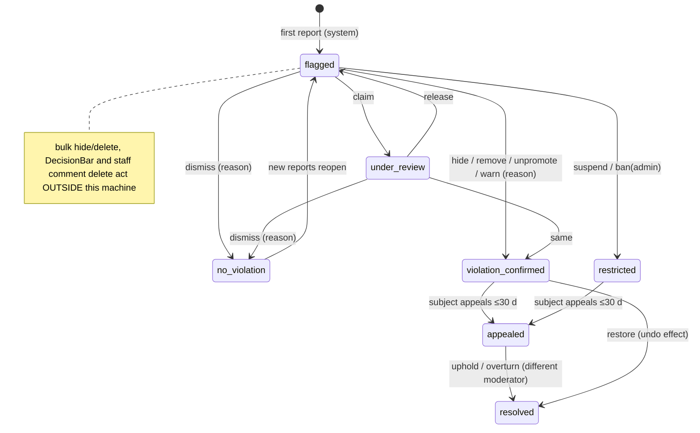
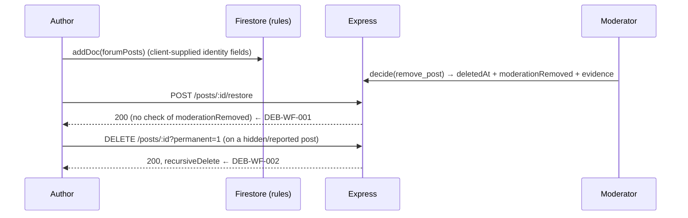

# Debati Publik — Social Network & Debate Administration: Forensic Audit

| | |
|---|---|
| **Repository** | `bardhiicloud-cell/zeri` (local worktree `claude/debati-publik-audit-813d2b`, HEAD `f8e13f1`, clean tree) |
| **Module audited** | Public Debate (`/forum`) as a social network + the Debate administration (`/debatwp`, `/moderim`, AdminPanel › Forum) and the server, rules, storage, jobs and integrations that power them |
| **Mode** | READ-ONLY. No project file, dependency, schema, config or production datum was modified. Only this report was created. |
| **Audit date** | 2026-10-15 |
| **Method** | Static trace of UI → client call → API / Firestore rules → transaction → side effects, plus **runtime probes against a local Firestore emulator** (demo project, throw-away scripts kept outside the repo) and the repository's own test suites. |

> Status vocabulary (as required): `CONFIRMED_DEFECT`, `CONFIRMED_MISSING`, `PARTIALLY_IMPLEMENTED`, `POTENTIAL_RISK`, `PASS_VERIFIED`, `NOT_TESTED`, `UNVERIFIED`.
> Where a finding was reproduced against the emulator it is tagged **[RUNTIME]**; where it rests on code reading alone it is tagged **[CODE]**.

---

## 1. Executive summary

The Debate module is considerably more mature than a typical prototype. Server-side transactions own comments, reactions, poll votes, edits, DMs, follows, reports and a genuinely good **moderation-case system** (`server/moderationCases.ts`: one case per target, claim/release/escalate, mandatory reasons, evidence copies, optimistic versioning, appeals decided by a *different* moderator, reversible effects, role-gated bans). Its unit and emulator suites pass (§13). Dangerous client writes were already moved server-side in earlier hardening.

The audit nevertheless found **a coherent set of defects concentrated in four seams**:

1. **The Firestore rules still trust the browser for the shape of a new post and do not enforce moderation state on reads.** A takedown is therefore cosmetic at the data layer: moderator-hidden and author-deleted posts are still returned to every client by the public feed query, and anyone can mint a post that claims to be an official (`authorRole:'admin'`, badge *Zyrtar Komunal*), carries a forged quote attributed to another person, or is back/future-dated. **[RUNTIME]**
2. **Authors can undo or destroy moderation.** A post a moderator removed can be restored by its author with one API call, and an author can permanently purge a post that is hidden/under report (destroying the evidence). **[RUNTIME]**
3. **Moderation is fragmented into four parallel paths** (case queue; bulk post actions; legacy `DecisionBar`; staff comment deletion). Only the first gives the person a reason, a notification, an appeal and an audit trail. The others bypass it, and the bulk UI never even sends a reason. **[CODE]**
4. **Everything that scales with engagement lives inside one Firestore document** (comments, replies, reactions, likes, reposts, poll votes). The 1 MiB document ceiling is reachable at ~950 comments+replies and then returns an unhandled 500; 40 simultaneous reactions on one post produced 26 failures. **[RUNTIME]**

Other high-value findings: DM text previews are readable by unrelated staff roles through the notifications rules; DM messages can be rewritten (including `senderId`) by a participant; expired verification ticks can never be renewed; the 30-day purge job exists but is never scheduled; there are no deep links to posts/comments/profiles and notifications do not navigate to the content they announce; search is client-side over ~50–80 loaded posts; and the composer/comment UI has weak accessibility.

**No claim is made that the platform is secure, production-ready or fully functional.** What was verified is listed in §13 and §17.

### Headline numbers

| Severity | Count | IDs |
|---|---|---|
| **P0** | 1 | DEB-SEC-001 |
| **P1** | 7 | DEB-SEC-002, DEB-SEC-003, DEB-WF-001, DEB-WF-002, DEB-DATA-001, DEB-DATA-002, DEB-PERF-001 |
| **P2** | 27 | see §14 |
| **P3** | 22 | see §14 |
| **P4** | 8 | §15 |

---

## 2. Audit scope and limitations

**In scope:** public Debate feed, composer, comments, reactions, polls, stories/reels (as part of the same social surface, audited lightly), profiles/follows/blocks, DMs, notifications, search, verification ticks, sponsored posts and the Debate payments; the Debate admin console, moderation cases, bulk post tools, legacy AdminForum tabs, account restriction, audit trail; the Firestore/Storage rules, Express routes, jobs and indexes that serve them.

**Out of scope (not audited in depth):** civic reporting pipeline, municipality desk, health registry, news, polls module, general auth.

**Limitations (honest list):**
- No dev server was started and no authenticated browser session was available, so **no UI was exercised at runtime**. All UI/UX/accessibility findings are from reading the components (`NOT_TESTED` at runtime). Contrast ratios, screen-reader output and real mobile layouts were not measured.
- No access to production/staging Firestore, Storage, Auth or Paysera. Production behaviours (index presence, transaction retry semantics, rate-limiter topology, Auth disable) are `UNVERIFIED` where noted.
- Runtime probes used the **Firestore emulator**, whose locking/contention behaviour is not identical to production. Concurrency numbers are indicative, not capacity data.
- Storage-rules behaviour was inspected statically; the repo's storage rules test was started but see §13 for its status.
- No load tests, no accessibility tooling (axe/Lighthouse), no malware scanning checks.

---

## 3. Repository and architecture inventory

| Layer | Technology / location | Notes |
|---|---|---|
| Client | React + Vite + TypeScript, Zustand store (`src/lib/store`), `react-router`, `firebase` web SDK | `src/pages/ForumPage.tsx` is a **2,683-line monolith** (feed, composer, comments, profile, explore, notifications host). |
| Server | Express (`server.ts`, 2,933 lines) + `server/*.ts` route modules; Firebase Admin SDK | Run with `tsx`/bundled CJS (`scripts/start-prod.cjs`); `trust proxy` = 1. |
| Data | **Cloud Firestore** (no SQL). Rules: `firestore.rules` (1,177 lines). Indexes: `firestore.indexes.json` (73). | Posts, comments, reactions and polls are **embedded in `forumPosts/{id}`**. |
| Files | Firebase Storage, `storage.rules` (130 lines) | Forum media is written to `reports/{uid}/forum/…` (shared prefix with civic-report evidence). |
| Auth | Firebase Auth (password, Google, **anonymous guests**), custom claims for roles | Guests may read the feed; writes need a non-guest profile. |
| Jobs | `setInterval` timers inside the API process: `publishDueScheduled` (60 s), `startSuspensionSweep` (5 min), work scheduler | **No scheduler for `purgeExpiredDeletedPosts`** (DEB-WF-007). |
| Payments | `server/payments*.ts`: IBAN reconciliation + Paysera (md5-signed callback) | Used for paid ticks and ad packages. |
| Tests | Vitest: `tests/server`, `tests/lib` (unit), `tests/rules`, `tests/emulator` (need emulators) | See §13. |

### 3.1 Data model (as found)

| Entity | Collection / path | Key fields | Integrity mechanism |
|---|---|---|---|
| Post | `forumPosts/{id}` | `authorId, content, visibility, isHidden, deletedAt, moderationRemoved, comments[], reactions{}, likes[], reposts[], poll{}, reportCount, needsReview, isAd, promotedUntil, viewCount, createdAt` | Rules (create only), server transactions (everything else) |
| Comment / reply | **array inside the post** (`comments[].replies[]`) | `id, authorId, content, createdAt` | Transaction on the whole post doc; caps 300 top-level / 100 replies |
| Edit history | `forumPosts/{id}/edits/*` | previous content, trimmed to 20 | Server |
| Post report | `forumPosts/{id}/reports/{reporterUid}` | `reason, note` | Doc id = reporter → one report per account |
| Other reports | `forumReports/{kind}_{target}_{reporter}` | snapshot, status open/closed | Server-created; staff may close |
| Moderation case | `moderationCases/{kind}_{targetId}` (+ `history/*`) | status, version, assignee, decision, lastEffect, appeal | Transactional state machine |
| Evidence | `moderationEvidence/*` (server-only) | full copy of removed post/comment | Two key shapes (`caseId` vs `postId`) |
| Conversation / message | `forum_conversations/{a_b}` (+ `messages/*`) | participants, status, unreadCount | Server-only writes; members read |
| Block / DM privacy | `forum_blocks`, `forum_dm_settings` | | Server-only |
| Notification | `notifications/*` | `userId, category, postId, commentId, message(≤200)` | Server-created |
| Verification | `users.isVerified/verifiedUntil`, `verificationRequests/{uid}`, `paymentOrders/{code}` | | Two request systems share `verificationRequests/{uid}` |
| Scheduled post | `forumScheduled/*` (server-only) | | |
| Audit | `auditLogs` (append-only, server writes) | actor, ip, path, detail | Rules deny client writes |

---

## 4. Complete route and component inventory

### 4.1 Public routes

| Route | Component | Purpose | Access | Data sources | Verification |
|---|---|---|---|---|---|
| `/forum`, `/:lang/forum` (`App.tsx:866,916`) | `ForumPage.tsx` via `GuestGuard` | Feed, composer, comments, explore, profile, notifications, DMs, reels, stories | Guests can read; writing needs a real account (guest → auth prompt) | Firestore live queries on `forumPosts`; REST `/api/v1/forum/*` | Code inspected; **not runtime-tested** |
| `/forum?reel=<id>` | same | Deep link to a reel (only deep link that exists) | public | `forumReels` | Code inspected |
| `/forum?create=post\|reel\|…` , `?payment=ok\|cancelled` | same | Create shortcuts, Paysera return | auth | — | Code inspected |
| `/verifikimi` (`:871`) | `VerificationRequestPage.tsx` | Ask for a tick (reason + https link) | non-guest | `/api/v1/forum/verification-requests*` | Code inspected |
| `/moderimi-im` (`:870`) | `MyModerationPage.tsx` | Citizen sees decisions about them, appeals | auth | `/api/v1/moderation/my-cases`, `/appeal` | Code inspected |
| `/partneret` (`:901`) | `PartnersPage.tsx` | Ad packages / pricing | auth for orders | `/api/v1/payments/*` | Code inspected |
| `/trackid` | `TrackIdPage` | Civic report lookup — **not Debate** | public | out of scope | — |

**Not found (CONFIRMED_MISSING after search for `forum/post`, `/post/`, `profile/:id`, `/u/`, `permalink` in `App.tsx` and `ForumPage.tsx`):** routes for an individual post, a comment permalink, a user profile, a hashtag, or a topic. Profiles, hashtags (`HashtagSheet`), reports (`ReportPostSheet`) and DMs (`DirectMessagesModal`) are in-page sheets/modals with no URL.

### 4.2 In-page surfaces of `/forum`

| Surface | File | Interactions traced |
|---|---|---|
| Feed + tabs (Për ty / Ndjek / Komuna / Sondazhe / Zyrtarë / Të ruajtura) + sort (foryou/recent/trending/hot) | `ForumPage.tsx` (`displayPosts` ~1128–1215), `useForumFeed.ts`, `forumRanking.ts` | load more, tab/sort switch |
| Composer | `ForumPage.tsx:791–905` | text, ≤4 images, poll, followers-only, category, municipality, schedule, ad (ads-admin only) |
| Quote post | `ForumPage.tsx:331–372` | quote modal |
| Comments & replies | `ForumPage.tsx:1015–1085, 2130–2290` | add, reply (1 level), delete, report |
| Reactions / like / repost / poll vote | `ForumPage.tsx:520–545, 897–1010` | server routes |
| Explore / search | `ForumExplore.tsx`, `HashtagSheet.tsx` | client-side search; hashtag = Firestore query |
| Notifications | `ForumNotificationsView.tsx`, `App.tsx:436–460` | All / Mentions |
| Profile, follow lists, settings | `ForumProfileTab.tsx`, `ForumSettingsPanel.tsx`, `forumPeopleApi.ts` | |
| DMs | `DirectMessagesModal.tsx` (729 lines) | requests, accept/decline, mute, hide, block, report user |
| Stories / Reels | `ForumStories.tsx`, `ReelsViewer.tsx`, `ReelComposer.tsx` | direct Firestore writes under rules |
| Saved posts | `ForumPage.tsx:388,516` | **localStorage only** |
| Insights / sponsored / ticks | `AccountInsightsSheet`, `SponsoredPostBar`, `VerificationModal` | |

### 4.3 Admin routes (Debate)

| Route / entry | Component | Role gate | Purpose |
|---|---|---|---|
| `/debatwp`, `/debatiwp` (`App.tsx:956–957`) and AdminPanel › "debate" | `DebateAdminPage` → `DebateConsole.tsx` | client `canAccessSection(user,'debate')`; **server** `requireSection('debate')` | Tabs: Përmbledhje, Moderimi, Pagesat, Kërkesat për tick, Verifikimet, Reklamat, Postimet |
| Tab *Moderimi* | `DebateModeration.tsx` → `/api/v1/moderation/*` | server `canModerate` = `debate` ∨ `forum` section | Case queue (canonical) |
| `/moderim`, AdminPanel › "moderim" | `ModerationCenterPage.tsx` | | A second host for the same moderation queue |
| Tab *Postimet* | `DebatePosts.tsx` → `/api/v1/debate/posts*` | `debate` section | List / bulk hide·unhide·delete·clear reports / promote |
| AdminPanel › "forum" | `AdminForum.tsx` (+ `DecisionBar`, `AdminForumReports`, `AdminReelReports`, `AdminForumStories`) | `forum` section; Firestore rules `isStaff()` | **Legacy** post approve/hide, comment/account/ad report queue, reels, stories |
| Tab *Pagesat* | `DebatePayments.tsx` | `debate` | Orders, IBAN statement matching, price/IBAN settings |
| Tabs *Kërkesat për tick* / *Verifikimet* / *Reklamat* | `DebateAdCreatorAndRequests.tsx`, `DebateAdsAndTicks.tsx` | `debate` | Verification queue, tick list, ad requests, sponsored posts |

### 4.4 Server endpoints (Debate-relevant)

`/api/v1/forum/posts/:id/{comments,reaction,poll-vote,action,report,view,restore,published}`, `PATCH|DELETE /forum/posts/:id`, `/forum/follow/:uid`, `/forum/people*`, `/forum/followers-feed`, `/forum/dm/*`, `/forum/blocks/:uid`, `/forum/scheduled`, `/forum/reports`, `/forum/verification*`, `/forum/verified-ids`, `/forum/reels*`, `/forum/analytics/*`; `/api/v1/moderation/*` (cases, summary, decide, appeal, my-cases, backfill); `/api/v1/debate/*` (posts, bulk, promote, reports, ads, ad-requests, verification-requests, verified, payments, stats); `/api/v1/payments/*`; `/api/v1/admin/users/:uid/moderate`; `/api/v1/admin/verification-requests*`.

---

## 5. Public Debate — feature-by-feature audit

### 5.1 Main feed and discovery

| Check | Result | Evidence |
|---|---|---|
| Public feed query | `PASS_VERIFIED` (functional) — live 50 newest `visibility=='public'`, `getDocs` pages of 30 | `useForumFeed.ts:87,143` |
| Hidden / moderated posts excluded server-side | **`CONFIRMED_DEFECT`** — query has no `isHidden` filter, rules do not check it; filtered only in the browser (`ForumPage.tsx:1132`); `recompute()` filters only `deletedAt` | **[RUNTIME]** DEB-SEC-001 |
| Soft-deleted posts excluded server-side | **`CONFIRMED_DEFECT`** — same | **[RUNTIME]** DEB-SEC-001 |
| Followers-only posts | `PASS_VERIFIED` (read path): public query cannot read them; followers get them via `/followers-feed` which re-checks follow/block/hidden/deleted (`forumFeed.ts`). Write-side leaks: reactions/poll votes (DEB-SEC-006) |
| Ranking | `PARTIALLY_IMPLEMENTED` — explainable pure module (`forumRanking.ts`: engagement × freshness × boosts; unit tests pass) but the **official boost is driven by client-supplied `authorRole`/`authorBadge`** (`forumRanking.ts:101–102`) → forgeable (DEB-SEC-002). No "why am I seeing this" UI (`CONFIRMED_MISSING`). |
| Search | **`CONFIRMED_DEFECT`/`PARTIALLY_IMPLEMENTED`** — `displayPosts` filters `content/authorName/category/neighborhood` over posts already in memory (≈50 live + loaded pages). Older posts are not searchable; hashtags are the only server query (`HashtagSheet.tsx:47–55`, limit 40). DEB-PUB-002 |
| Category / municipality filters | `PARTIALLY_IMPLEMENTED` — client filters; a post with empty `neighborhood` passes every municipality filter (`ForumPage.tsx:1160`) |
| Pagination | `PARTIALLY_IMPLEMENTED` — cursor paging works; after filters/search the "load more" continues the *unfiltered* cursor, so a filtered tab can look empty while more pages exist |
| New-post indicator | `CONFIRMED_MISSING` — live snapshot silently inserts/reorders; no "N new posts" affordance |
| Duplicate/ordering | merge by id (`mergePostSources`), ordered by client-controlled `createdAt` (DEB-SEC-002: a 2099 date is accepted **[RUNTIME]**) |
| Pinned/announcement | `CONFIRMED_MISSING` (only paid `isAd` promotion exists) |
| Trending sidebar | `PARTIALLY_IMPLEMENTED` — computed from loaded posts, reshuffled every 10 s by `setInterval` (`ForumPage.tsx:~535`) → moving content (DEB-UX-005) |
| Empty/loading/error | Loading has a 2 s safety timer; error is `console.warn` only — **no visible error state** for a failed feed (`useForumFeed.ts:97`) |

### 5.2 Post creation and publishing

Trace: composer (`ForumPage.tsx:791`) → `uploadFileToStorage` ×≤4 (`firebase.ts:218`) → **`addDoc(forumPosts)` directly from the browser** (`:850`) → `notifyPublishedApi` (`POST /posts/:id/published`) for quote/mention notifications → toast.

| Check | Result |
|---|---|
| Server-side validation of new posts | **`CONFIRMED_DEFECT`** — there is none; the write is governed only by rules, which check `authorId`, `content.size()<=5000`, `visibility`, empty engagement arrays and `isAd`. They do **not** validate `authorName`, `authorRole`, `authorBadge`, `authorAvatar`, `quotedPost`, `createdAt`, `imageUrl(s)`, `poll.options[].votes`, `category`, `neighborhood`, `hashtags`. **[RUNTIME]** all accepted (§9, DEB-SEC-002). |
| Empty content | **`CONFIRMED_DEFECT` [RUNTIME]** — rules accept `content: ''`. UI path: a poll question with <2 valid options publishes a post with **no poll and no text** (`ForumPage.tsx:837` silently yields `pollData=null`). |
| Length | Rule cap 5,000; **no `maxLength` and no counter** on the textarea (`:1651`), so over-length ends in the generic "Gabim gjatë publikimit". |
| Double submit | `PARTIALLY_IMPLEMENTED` — button `disabled={isSubmitting}` (`:1713`) but `handleCreatePost` has no re-entrancy guard and no idempotency key; two events before React re-renders create two posts. `POTENTIAL_RISK`. |
| Upload failure | Files upload sequentially; if upload N or the `addDoc` fails, earlier files stay in Storage (orphans), no cancel UI, no progress UI. DEB-DATA-007. |
| Sanitisation | `PASS_VERIFIED` (render side): no `dangerouslySetInnerHTML` in `ForumPage.tsx`, `components/forum/*`, `components/debate/*`; text rendered via React. Server `cleanText` normalises newlines for comments/edits/scheduled posts, **but direct post create is not normalised**. |
| Links/mentions/hashtags | Hashtags extracted client-side and stored (`hashtags` unvalidated, rule does not cap); mentions verified server-side before notifying (`forumPosts.ts:255–267`) — `PASS_VERIFIED` by unit tests. |
| Draft preservation | `PASS` — `loadDraft/saveDraft` per user (600 ms debounce). |
| Unsaved-changes guard | `CONFIRMED_MISSING`. |
| Edit | `PASS_VERIFIED` (server): author only, not while hidden, history kept (≤20), rate-limited 15/min (`forumPosts.ts:326`). **Moderation re-check after edit: none** (edit does not re-open a closed case or re-run any filter) — acceptable but noted. |
| Delete | Soft delete (author) → restorable 30 days; permanent via `?permanent=1`. See DEB-WF-001/002/007. |
| Scheduling | `PASS` (server-validated: ≥5 min, ≤30 d, ≤20 pending, https images). Publishes as `authorBadge:'Qytetar i Verifikuar'` for everyone with ≤100 points (DEB-PUB-005). Uses raw `isBanned` instead of `isRestricted` (DEB-WF-008). |
| Rate limit on post creation | `CONFIRMED_MISSING` — none (writes are direct Firestore). Spam posting is bounded only by Firestore quotas. DEB-SEC-016. |

### 5.3 Comments and threaded conversations

| Check | Result |
|---|---|
| Create | `PASS_VERIFIED`: `POST /posts/:id/comments` transaction, identity from token, restricted/guest/blocked/followers-only/`whoCanComment` checks, ≤1000 chars, 20/min/user (`forumPosts.ts:189–271`). |
| Edit comment | `CONFIRMED_MISSING` (no route, no UI). |
| Delete | Commenter, **post author** or any staff claim (`forumPosts.ts:283`). **No audit entry, no reason, no evidence copy, no notification** when staff delete (DEB-WF-005). |
| Nesting | Server supports exactly one level (reply → top-level comment). UI offers "Përgjigju" on top-level comments only; replying *to a reply* is impossible (`CONFIRMED_MISSING`). |
| Parent deleted | `removeComment` filters the parent, **dropping all its replies** with no tombstone (`forumPosts.ts:101`). DEB-DATA-006. |
| Capacity | Caps 300 top-level × 100 replies = 30,030 items **but the document limit is 1 MiB** → **[RUNTIME]** 300 top-level + 646 replies of 1,000 chars were accepted, the next write failed with `INVALID_ARGUMENT: maximum entity size is 1048576 bytes`, an **unhandled** error (generic HTTP 500, not a `PostError`). DEB-DATA-001. |
| Ordering / pagination | Insertion order; whole thread ships inside the post document in the feed (no comment pagination). DEB-PERF-001. |
| Counts | Feed shows `comments.length` (top-level only); admin list counts top-level only (`debateAdmin.ts toPostRow`). Replies are not counted. |
| Hidden post | Commenting blocked on hidden posts (`:197`); **deleting** a comment is allowed (fine). |
| Locked discussions | `PARTIALLY_IMPLEMENTED` — author can set `whoCanComment` = nobody/followers (account-level pref), no per-post lock, no moderator lock. |
| Notifications | Parent author notified per comment with a random id → **no dedupe**; 100 replies = 100 notifications to the parent author (rate-limited per replier only). |
| Report a comment independently | `PASS_VERIFIED`: `POST /forum/reports kind=comment` validates the comment exists, not self-report, snapshots text, one per reporter, creates/updates the case (`forumReports.ts`). |
| Concurrency | Single doc: see DEB-DATA-002. |
| UI | Comment input is a bare `<textarea>`/`<input>` with placeholder only; submit button labelled **"Përgjigju"** (same word as the reply action); send-icon button in the reply box has no accessible name; dates shown without time; native `window.confirm` for delete. DEB-UX-001/002/003. |

### 5.4 Reactions and engagement

| Mechanism | Persisted server-side | Idempotent / toggling | Authorization gaps |
|---|---|---|---|
| Reaction (6 types) `PUT /posts/:id/reaction` | yes, transaction, one per account, same type toggles off (`applyReaction`, unit-tested) | yes | **Does not check followers-only visibility or blocks** — **[RUNTIME]** a non-follower reacted to and voted in a followers-only post (DEB-SEC-006). Respects deleted/hidden/restricted. |
| Poll vote | yes, one active vote per account, moves/withdraws | yes | same gap as above |
| Like / repost `POST /posts/:id/action` (`server.ts:1661`) | yes, array toggle in a transaction | yes | **Inline handler with none of the checks above**: no restricted/suspended check, no guest check, no deleted/hidden check (it loads the raw doc), no block or followers-only check, **no rate limit**, and one `auditLogs` document per click (log flooding). DEB-SEC-005. |
| Repost permission | `allowReposts` pref enforced **in the browser only** (`ForumPage.tsx:945`) — server does not check it. |
| Save (bookmark) | **localStorage only** (`saved_forum_post_ids`) → not synced across devices, lost with site data, guests and users alike. DEB-PUB-003. |
| Follow | server (`forumPeople.ts setFollow`) idempotent, blocks respected, 60/min — `PASS_VERIFIED`. Uses raw `isBanned` (DEB-WF-008). |
| Views | `POST /posts/:id/view` counts one per account via `viewers/{uid}`; accounts include **anonymous guests**, so `viewCount` (used in ads/insights) can be inflated by minting guests. Does not check hidden/deleted. DEB-SEC-011. |
| Counter consistency | Counts are derived from array lengths, so they cannot drift from the data — `PASS_VERIFIED` by design (but see DEB-DATA-003/002 for scale). |
| Optimistic UI | like/repost/poll roll back on failure (`ForumPage.tsx:951,921`). |

### 5.5 Profiles and social relationships

| Check | Result |
|---|---|
| Public profile fields | Only name/avatar/follower count/prefs are served by `/forum/people` (`forumPeople.ts toUserLite`); email/phone not exposed — `PASS_VERIFIED` (unit tests). |
| Directory exposure | **`POTENTIAL_RISK`/DEB-SEC-014:** `GET /forum/people?q=` is available to **any authenticated token including anonymous guests** and enumerates every non-banned account's real name and avatar (≤500/call). There is no "private profile" or "hide me from search" setting. Legal/product confirmation needed. |
| Scale | The graph is computed from `users.limit(2000)` held in memory (comment in file admits "fine into the low thousands"). Beyond 2,000 accounts follower counts, People tab and follow lists are **silently wrong**; `verified-ids` is capped at 1,000 (`forumSocial.ts:123`). DEB-DATA-004. |
| Follower/following lists | Honour `showFollowLists` — `PASS_VERIFIED`. |
| Blocks | Server enforces on DM send, follow, comment, followers-feed. **`CONFIRMED_MISSING`:** blocked authors' public posts/comments still appear in the public feed; block/mute can only be reached from the DM modal; no mute. DEB-PUB-006. |
| Suspended/deleted accounts | People list drops `isBanned`; posts of banned authors stay visible (no cascade). Account erasure anonymises posts and comments (§10, DEB-DATA-005). |
| Avatar | Storage rule: raster image ≤5 MB, owner only; no re-encode/EXIF strip. |

### 5.6 Notifications and real-time

Lifecycle: action → server creates `notifications/{id}` (`noteDoc`, `notifyOnce` with deterministic ids for like/repost/quote/mention/follow; **random id for comments/replies**) → client listener `where userId==uid` (`App.tsx:440`) → `ForumNotificationsView` → click → `updateDoc(isRead:true)`.

| Check | Result |
|---|---|
| Recipient selection | server-side from stored post/comment; mention targets verified against the text; prefs honoured (`wantsNotification`) — `PASS_VERIFIED`. |
| Authorization to read | Owner or **`isStaff()`** (rules `:364–367`) — **[RUNTIME]** `agent`, `newsadmin`, `adsadmin`, `approver` can read *another user's* notification, which for DMs carries the first 200 chars of the message. Plain citizen: denied. DEB-SEC-003. |
| Deep link | **`CONFIRMED_DEFECT`:** `postId`/`commentId` are stored but never used; `link` is always `/forum`; the click handler only marks read (and opens the DM modal for `forum_dm`). The user lands nowhere near the content. DEB-PUB-001. |
| Unbounded listener | `query(notifications, where userId==uid)` with **no `limit` and no pagination** (`App.tsx:440–442`); notifications have no TTL. DEB-PERF-003. |
| Owner can alter | Owner `update` rule has no field restriction → a user can rewrite title/message/link of their own notification **[RUNTIME]** (self-only impact; P3). |
| Duplicate prevention | like/repost/quote/mention/follow once per (kind, post, actor); comment notifications not deduped. |
| Retry/failure | `notifyOnce` swallows failures (`console.warn`); like/repost notification is fire-and-forget **after** the commit — a crash between commit and notify drops it permanently (acceptable for low-priority). Comments notify **inside** the same transaction (atomic). |
| Real-time | Firestore `onSnapshot` for feed (50), own posts (50), DM conversations, notifications. Cleanup on unmount present. Followers feed is **polled every 60 s** per open tab (+ on focus) and costs up to ~1,000 `forum_blocks` reads per call (500 follows × 2) — DEB-PERF-002. |

### 5.7 Direct messages

| Check | Result |
|---|---|
| Membership on read | `PASS_VERIFIED` **[RUNTIME]**: non-member cannot read the conversation or a message; listing relies on `participants array-contains`. |
| Create / send | Server only (`rules: create,update: false`); blocks, privacy (`everyone|following`), request flow (stranger → request, 3-message cap), mute, hide, unread counters server-owned — emulator tests pass (§13). |
| Rate limit | 30/min/user, **in-memory per process** (DEB-SEC-013). |
| Tampering | **`CONFIRMED_DEFECT` [RUNTIME]:** `messages/{id}` `update` has no field restriction; a participant who authored a message may change its `text` **and its `senderId` to the other participant**, forging a message "from" them; delete by the participant was denied in the probe, but edit is enough to destroy/forge evidence. DEB-SEC-004. |
| Notification content | previews of DM text are placed in `notifications.message` (DEB-SEC-003). |
| Attachments | `imageUrl` may be any `https` URL (or http localhost) — not restricted to the app's Storage → third-party tracking when the recipient's client loads it (DEB-SEC-009). Storage `forum_dms/{uid}/**` read limited to uploader (good). |
| Abuse reporting | A DM thread can be reported only as a **user** report whose snapshot is just the name (`forumReports.ts`). Moderators cannot see the conversation, and there is no reporter-attached evidence. `CONFIRMED_MISSING` — DEB-PUB-012. |
| Retention / deletion | Account erasure removes the person's authored messages and redacts the profile (`gdpr.ts:231–`); no TTL for ordinary messages. |

### 5.8 Search, categories, navigation

See §5.1. Additional: filters are not reflected in the URL, so refresh/back lose them; there is no deep link to a post/comment/profile/hashtag; `?reel=` is the only parameter. Footer links "Privatësia / Kushtet / Reklamimi / Rreth Nesh / Aksesueshmëria" are `href="#"` dead links (`ForumPage.tsx:2444–2448`, DEB-PUB-009).

### 5.9 Public UI/UX and accessibility (static review)

Findings are in §12. Evidence base is the source; nothing was measured in a browser.

---

## 6. Debate administration — module-by-module audit

### 6.1 Inventory and ownership

| Module | Where | Backend | Status |
|---|---|---|---|
| Overview | `DebateConsole` overview | `GET /debate/stats` | `PARTIALLY_IMPLEMENTED` — see 6.6 |
| **Moderation cases** (canonical) | `DebateModeration.tsx`, `ModerationCenterPage.tsx` | `server/moderationCases.ts` | **Strong**; `PASS_VERIFIED` by unit + emulator tests |
| Post management | `DebatePosts.tsx` | `server/debateAdmin.ts` `/debate/posts*` | `PARTIALLY_IMPLEMENTED` — bypasses cases |
| Legacy forum admin | `AdminForum.tsx` + `DecisionBar` | `server/decisions.ts` (generic `forum` kind: approve/hide/unapprove) | duplicate path |
| Comment/user/ad reports | `AdminForumReports.tsx` | direct Firestore `updateDoc(forumReports)` + `DELETE comment` | duplicate path |
| Reels / stories moderation | `AdminReelReports`, `AdminForumStories` | Firestore rules `isStaff()` | outside case system |
| Verification (two systems) | `DebateVerificationRequests` (debate) and `VerificationModal`'s staff queue (`users` section) | `/debate/verification-requests*` vs `/admin/verification-requests*` | conflicting (DEB-WF-006) |
| Ticks | `DebateTicks` | `/debate/verified*` | revoke without reason/notification |
| Ads | `DebateAdCreator`, `DebateAds`, `promote` | `/debate/ads`, `/debate/posts/:id/promote`, `/debate/ad-requests*` | works; ad image/link https-only |
| Payments | `DebatePayments.tsx` | `server/paymentRoutes.ts` | solid ledger logic; governance gaps |
| Account moderation | AdminPanel › users | `userModeration.ts` (`ban|unban|verify|unverify`) | third ban path |
| Audit trail | `auditLogs` | `server/auth.ts:188` | see 6.8 |
| Moderator analytics, SLAs, saved views, keyboard shortcuts | — | — | `CONFIRMED_MISSING` |
| Payment/refund | refunds/credits | — | `CONFIRMED_MISSING` (no refund route; paid orders cannot be cancelled) |

### 6.2 Moderation queue and case management

| Capability | Result | Evidence |
|---|---|---|
| One case per target, report aggregation, snapshot kept | `PASS_VERIFIED` | `applyReportToCase`, tests |
| Priority | derived from reasons/volume (`priorityFor`) | tests pass |
| Filters | queue / mine / escalated / by status / by subject; `kind` filter on queue only | `moderationCases.ts` list route |
| Search by case/post/user ID or text | **`CONFIRMED_MISSING`** (only `view=subject&uid=`) |
| Assignment | claim/release; admins may take over with a recorded reason | `decideCase` |
| Concurrency | `PASS_VERIFIED`: transaction + `version` + `expectedVersion`; emulator test "two moderators claiming at once: exactly one gets it" passes. If a client omits `expectedVersion` the state machine still prevents contradictory outcomes (`WRONG_STATE`). |
| Case history | per-case `history` subcollection; read in detail view (100) |
| Notes | reason is the note; no free-form internal comments |
| Bulk actions | none on cases (good) — bulk exists only on posts (6.3) |
| Pagination | cursor, 25–100 |
| Escalation | flag only; no routing, no SLA, no overdue view (`PARTIALLY_IMPLEMENTED`) |
| Reporter feedback | reporters are never told the outcome (`CONFIRMED_MISSING`, DEB-ADM-007) |
| Lifecycle | see §8.1 diagram. Names follow `moderation_case` workflow definitions. |

### 6.3 Post and comment moderation actions

| Action | Who (server) | Persisted | Author notified | Reason stored | Reversible | Audited |
|---|---|---|---|---|---|---|
| Case: hide / remove / unpromote | `debate`∨`forum` section, case state machine | yes, in the decision transaction | yes (`moderation` notification) | mandatory 5–300 chars | `restore`, `overturn` | yes (`moderation.*`) |
| Case: remove comment | same | evidence copy + removal | yes | mandatory | yes (reinsert) | yes |
| **Bulk hide/unhide/delete/clear_reports/unpromote** (`/debate/posts/bulk`) | `debate` section | batch (non-transactional `getAll`→`batch`) | **no** | **client never sends one** (`bulkPosts(action,ids,confirm)` — `DebatePosts.tsx:64,80`) → server stores `''`/`null` | hide↔unhide only; delete = hard delete (evidence copy keyed by post id) | yes, but `reason:null` |
| Legacy `DecisionBar` hide/approve (`decisions.ts`) | `forum` section | `isHidden/isApproved` | no | `needsReason` for hide | approve/unapprove | via decisions route |
| Staff delete comment (`AdminForumReports`, in-feed "Fshi") | **any** claim in `STAFF_CLAIMS` (incl. `adsadmin`, `newsadmin`) | removes element | no | no | no | **no** |
| Story/reel hide | rules `isStaff()` direct client write | yes | no | optional | yes | no |

Consequences: DEB-WF-003/004/005, DEB-ADM-001. **Open case vs bulk actions:** a bulk `delete` leaves the case `flagged`; later `hide` returns `TARGET_GONE`. A bulk `unhide` of a case-hidden post leaves the case `violation_confirmed/lastEffect=hide`, so `restore` later "undoes" something already undone.

**Evidence retention:** `moderationEvidence` (server-only) holds removed posts; keyed `post_<id>` (cases) or `<id>` (bulk) → an appeal cannot find bulk-deleted content.

### 6.4 User moderation and account lifecycle

- Warn / suspend 1–90 d / ban (admins only) / restore / appeal-by-different-moderator: `PASS_VERIFIED` (unit + emulator).
- Suspension enforcement: server routes use `isRestricted()`; Firestore rules `isBanned()` honours `suspendedUntil`. Direct-API bypass attempts: comments/reactions/polls/edits/DMs/reports all go through `loadActor` → blocked. **Exceptions:** `POST /posts/:id/action` (like/repost) and `/posts/:id/view` do not check restriction (DEB-SEC-005); `setFollow` and scheduled posts use raw `isBanned` (DEB-WF-008); Storage rules do not check restriction (DEB-SEC-008).
- Ban also disables Firebase Auth and revokes tokens, **outside** the transaction; failure yields a warning only (DEB-WF-009).
- Second, independent ban path: `POST /admin/users/:uid/moderate` (`users` section) sets `isBanned` w/o case, appeal or notification (DEB-WF-010).
- Moderators cannot touch staff/municipal subjects (`STAFF_SUBJECT`) — good.
- `warningCount` is incremented/decremented; no automatic escalation by repeat offences (reported only as `priorCases` list in detail).

### 6.5 Roles and permissions

See §7.

### 6.6 Dashboard and metrics (`GET /debate/stats`, `debateAdmin.ts:499`)

| Metric | Calculation | Issue |
|---|---|---|
| `posts` | `forumPosts.count()` | includes soft-deleted and hidden posts |
| `reported` | `reportCount > 0` | counts posts whose reports were "cleared" or decided as 0; includes deleted |
| `hidden` | `isHidden == true` | ok |
| `verifiedAccounts` | `isVerified == true` count | includes **expired** ticks (no sweep) |
| `paidLast30Days` | `status=='paid' & paidAtMs >= now-30d`, **`.limit(500)`**, sum computed from ≤500 docs | silently truncated; `count` = `paid.size` (≤500) — wrong above 500 payments/month |
| Index | `paymentOrders (status, paidAtMs)` is **not declared** in `firestore.indexes.json` → the whole `Promise.all` (and the Overview) fails with a 500 unless a console-created index exists (`UNVERIFIED`, DEB-DATA-008) |
| Cache | 30 s per process |
| Not present | open cases, awaiting review, oldest-flagged age (exists on `/moderation/summary` but not on the overview), average time-to-decision, overdue cases, repeat offenders, appeal volumes/outcomes, moderator workload, spam trend, restore trend. These are **proposed**, computable from `moderationCases.history`. |
| Time zone | all `Date.now()`/epoch-ms → no TZ ambiguity; labels use `sq-AL` locale. |

### 6.7 Payments (found, so audited)

Strengths: unique unguessable-enough codes created with `create()`; one transaction flips `awaiting→paid` and applies the effect; amount check; Paysera callback verifies `md5(data+password)`, re-reads order, validates amount/currency, idempotent (`already_paid`); statement-matching re-parses server-side; every confirm is audited under the staff uid; unit tests pass.

Findings: **no refund / reversal** and a paid order cannot be cancelled (`cancelOrder` returns `already_paid`); a Paysera callback that arrives for a *cancelled* order returns `OK` (stops retries) while the money is received and no alert is raised (`paymentRoutes.ts` callback → `confirmOrder` outcome `cancelled` only logged to audit); manual IBAN confirm skips the amount check when `amountEur` is omitted (`confirmOrder` only compares when `receivedEur` is a number); **IBAN, beneficiary and prices are editable by the same single role that confirms payments**, with no second approver and an audit entry that records only `ibanSet: true` — the previous/new IBAN are not logged (DEB-ADM-009); signature comparison is a plain `!==` on an md5 digest (protocol-mandated hash; timing risk negligible) — `POTENTIAL_RISK`/P3. Money paths were **not** run against Paysera (`NOT_TESTED`).

### 6.8 Audit trail

- `auditLogs`: rules deny every client create/update/delete (even superadmin) → moderators cannot alter it (`PASS_VERIFIED` by rules tests).
- `audit()` is **fire-and-forget** and swallows failures (`server/auth.ts:188`). A failed audit write does not fail the action: an action can succeed with no record. Stores `req.ip` and `path` for every entry; no correlation/request id; no hash chain. DEB-ADM-008.
- Not audited: staff comment deletion (`forumPosts.ts` delete route), story/reel hide via rules, bulk reasons, IBAN old/new values, `revoke` tick reason.

### 6.9 Admin usability (static)

- Case UI is thoughtful: priority sort, mobile master/detail, destructive styling, version-conflict handling.
- *Postimet* tab: selection checkboxes and a sticky bulk bar; destructive bulk uses `window.confirm`; **no reason field**; "Pastro raportimet" (clear reports) is a one-click bulk that also discards the review flag.
- Three navigation entry points to overlapping tools (Moderimi tab, *Postimet* tab, AdminPanel › Forum, AdminPanel › Moderim, `/moderim`) with different rules and different history → operator confusion.
- Search covers only the newest 400 posts (`source.limit(400)`, `debateAdmin.ts:149–153`) and the post list does not expose `deletedAt` (a post the author deleted still looks "visible").
- No keyboard shortcuts for queue processing, no saved views, no SLA/overdue badges.

---

## 7. Role and permission matrix (from actual code)

Sources: `src/lib/adminPermissions.ts:120–138` (`BY_ROLE`), `server/policy.ts`, `server/moderationCases.ts:162–163`, `server/forumPosts.ts:40`, `firestore.rules:46–55`. Probe **P6** executed `decideCase` for each role.

| Role (claim) | `debate`/`forum` section (server) | Case: suspend / ban | Delete any comment (API) | Firestore `isStaff()` | Notes |
|---|---|---|---|---|---|
| `superadmin`, `admin` | all | allow / **allow** | yes | yes | owner-level |
| `debatwp` | `debate` + `forum` | allow / deny | **no** (not in `STAFF_CLAIMS`) | **no** | Debate admin is *not* `isStaff()` → cannot read `forumReports`/hidden stories via rules, only via server |
| `approver` | `forum` | allow / deny | yes | yes | civic-report approver also moderates the debate |
| `newsadmin` | `forum` | allow / deny | yes | yes | editor can suspend citizens |
| `agent` | `forum` | allow / deny | yes | yes | frontline agent |
| `responder`, `dispatcher` | `forum` | allow / deny | **no** | **no** | emergency/dispatch roles can suspend citizens via the case API |
| `adsadmin` | none | deny / deny | yes | **yes** | no section, yet `isStaff()` lets it read **all** notifications, `forumReports`, and hide/delete any story or reel, and the API lets it delete any comment |
| `moderator` (assignable role) | **none** (no `BY_ROLE` entry) | **deny** | no | no | the one role literally named *moderator* cannot moderate (dead role) |
| `monitor` | none (read-only oversight) | deny | no | no (reads via `isMonitor`) | |
| citizen | — | — | own comment, or comments on own post | no | |
| guest (anonymous) | — | — | — | no | can read feed; can call like/repost/view/people APIs (DEB-SEC-005/011/014) |

| Debate action | Classification |
|---|---|
| Hide/remove/unpromote/warn/suspend a case target | Allowed within scope (`debate`∨`forum`), with mandatory reason |
| Permanent ban / un-ban | Allowed only for `admin`/`superadmin` |
| Decide an appeal | Allowed only to a moderator who did **not** decide |
| Bulk hide/delete/clear (posts) | Allowed within `debate` scope **without** reason or approval |
| Confirm payment / change IBAN & prices | Allowed within `debate` scope; no second approver |
| Grant/revoke tick | Allowed within `debate` scope |
| Change roles | `admin`/`superadmin` only (`checkRoleChange`); self-change denied |
| Read DM content | Denied (no staff route) — but see DEB-SEC-003 for previews |
| Delete audit records | Denied to everyone (rules) |

Mismatches to resolve: rules `isStaff()` (admin, superadmin, approver, adsadmin, newsadmin, agent) vs server sections (adds debatwp, responder, dispatcher; excludes adsadmin) vs `STAFF_CLAIMS` — three different definitions of "debate staff". Proposed minimal model in §14 (DEB-SEC-007).

---

## 8. User journeys and workflow diagrams

### 8.1 Report → case → decision → appeal (as implemented)



### 8.2 Parallel moderation paths (the fragmentation)

```mermaid
flowchart LR
    R[Citizen report] --> C[moderationCases<br/>reason + notify + appeal + audit]
    S1[Debate › Postimet bulk] --> P[(forumPosts.isHidden / hard delete)]
    S2[AdminForum DecisionBar] --> P
    S3[AdminForumReports 'Fshi komentin'] --> CM[(comments[])]
    S3 --> FR[(forumReports.status=closed)]
    C --> P
    C --> CM
    S1 -. no case, no reason sent, no notice .-> X1[author unaware]
    S3 -. no evidence, no audit .-> X2[case stays open]
```

### 8.3 Post lifecycle and where moderation can be undone



### 8.4 Notification journey

```mermaid
flowchart LR
    E[Comment / like / mention / DM] --> N[notifications/{id} server-created]
    N --> L[client onSnapshot userId==uid  (no limit)]
    L --> V[ForumNotificationsView]
    V -->|click| MR[mark isRead only]
    MR -.postId/commentId unused.-> X[user not taken to content]
    N -. isStaff() read .-> ST[agent/newsadmin/adsadmin/approver see DM previews]
```

### 8.5 Citizen journey for a tick

`/verifikimi` (reason+link) → `verificationRequests/{uid}` → Debate admin approve (30 d) **or** pay via `paymentOrders` → `confirmOrder` sets `isVerified+verifiedUntil`. After 30 days `activeVerifiedIds` hides the tick, but `isVerified` stays `true`, so `POST /payments/orders` and `/forum/verification-requests` both answer **409 "already verified"** — the person cannot renew (DEB-WF-006).

---

## 9. Security and privacy findings

### 9.1 Runtime probe results (Firestore emulator, `firestore.rules` as committed)

| Probe | Outcome |
|---|---|
| R1a guest `get` of a moderator-hidden post | **ALLOWED** |
| R1b guest `get` of an author-soft-deleted post | **ALLOWED** |
| R1c the exact public feed query (`visibility==public`, orderBy createdAt, limit 50) returns hidden and deleted docs | **returned `del1,hid1`** |
| R2a citizen creates post with `authorRole:'admin'`, `authorBadge:'Zyrtar Komunal'`, `authorName:'Kryeministri i Kosovës'` | **ALLOWED** |
| R2b post with forged `quotedPost` (other person's name + invented words) | **ALLOWED** |
| R2c `createdAt` = 2099-01-01 | **ALLOWED** |
| R2d poll with 500 pre-filled fake votes (`totalVotes:0`) | **ALLOWED** |
| R2e `http://` third-party image URLs | **ALLOWED** |
| R2f empty content, no media | **ALLOWED** |
| R2g client-set `authorVerified/isVerified` on the post | **ALLOWED** (not trusted by the UI today, but unvalidated) |
| R2i guest creates post | DENIED (good) |
| R3a/R3b DM participant rewrites own message text / sets `senderId` to the other participant | **ALLOWED** |
| R3c participant deletes message | DENIED |
| R4 `agent`/`newsadmin`/`adsadmin`/`approver` read another user's DM-preview notification | **ALLOWED** (citizen: DENIED) |
| R4z owner rewrites title/message/link of own notification | **ALLOWED** |
| R5a/b non-member reads conversation / message | DENIED (good) |
| R6a/b author un-hides own moderated post / edits content directly | DENIED (good) |

Server-function probes (Admin SDK on the emulator): **P1** author restore of a moderator-removed post → `restored:true`; **P2** author permanent purge of a hidden post → document gone; **P3/P3b** non-follower reaction and poll vote on a followers-only post → allowed; **P4** comment ceiling (see 5.3); **P5** 40 concurrent reactions on one post → 14 OK / 26 `ABORTED: Transaction lock timeout` in 20.6 s; **P6** role matrix (§7); **P7** admin ID search is case-insensitive and works (a suspected defect that **did not reproduce** — recorded for transparency).

### 9.2 Security/privacy defect summaries

(Full records in §14.)

- **DEB-SEC-001 (P0)** — moderation/deletion not enforced in rules or feed query.
- **DEB-SEC-002 (P1)** — post-create rule lacks field validation → official impersonation, forged quotes, ranking/date manipulation, vote seeding, tracking URLs.
- **DEB-SEC-003 (P1)** — `isStaff()` read of `notifications` exposes DM/comment previews to unrelated staff roles.
- **DEB-SEC-004 (P2)** — DM message update rule unconstrained.
- **DEB-SEC-005 (P2)** — like/repost/view endpoints skip restriction/visibility/guest checks and rate limits; each click writes an audit document.
- **DEB-SEC-006 (P2)** — reaction/poll vote ignore followers-only and blocks.
- **DEB-SEC-007 (P2)** — three conflicting definitions of debate staff; over-permission of `adsadmin`, `newsadmin`, `agent`, `approver`, `responder`, `dispatcher`; dead `moderator` role.
- **DEB-SEC-008 (P2)** — Storage rules accept uploads from anonymous guests and suspended accounts; one public `reports/` prefix; client-asserted content type only; no EXIF strip, malware scan or SVG-by-sniffing (rules only block declared SVG).
- **DEB-SEC-009 (P3)** — arbitrary external image URLs in posts and DMs (IP/read tracking).
- **DEB-SEC-010 (P3)** — owner may rewrite their own notification documents.
- **DEB-SEC-011 (P3)** — view counter and `viewers/*` growth inflatable via anonymous accounts.
- **DEB-SEC-012 (P2)** — single-role control of IBAN/prices/confirmation; incomplete audit.
- **DEB-SEC-013 (P3)** — `createRateLimiter` is an in-process `Map` that is never pruned for idle keys; ineffective across instances (`POTENTIAL_RISK`, deployment topology `UNVERIFIED`).
- **DEB-SEC-014 (P2)** — directory enumeration by guests.
- **DEB-SEC-016 (P3)** — no rate limit on direct post creation / stories / reels / story views.

**Checks that passed (`PASS_VERIFIED`):** no stored XSS vector in the Debate render path (React text rendering, no `dangerouslySetInnerHTML`); object-level authorization on server mutations (comment/edit/delete/restore/follow/DM/appeal use token uid, never client ids); report target validation (kind whitelist, existence, self-report ban, one per reporter); users cannot self-assign privileged fields; audit logs append-only; non-members cannot read conversations; payment amount/currency and callback signature checks; appeals cannot be decided by the original moderator; CSRF is not applicable (bearer-token API, no cookie auth for these routes — `UNVERIFIED` for any cookie-authenticated route outside scope).

**Privacy/legal questions for confirmation (not asserted as compliant or non-compliant):** retention of DM previews in `notifications`; lawful basis and retention for `auditLogs.ip`; whether guests may enumerate names; whether post images under `reports/{uid}/forum/` must be erased on account deletion (they are kept — `gdpr.ts:95–104` keeps `reports/`); `quotedPost` copies of a deleted user's name/content in other posts; `moderationCases.snapshot`/`moderationEvidence` after erasure; `verificationRequests` (name, email) and `paymentOrders` (name, email) retention.

---

## 10. Database and integrity findings

Traced scenarios (task §7):

| # | Scenario | Current behaviour | Verdict |
|---|---|---|---|
| 1 | Publish + double-click | Two `addDoc` calls possible; no idempotency key | `POTENTIAL_RISK` (DEB-PUB-008) |
| 2 | Two moderators act on one report | Transaction + version + status check; second gets `WRONG_STATE`/`STALE`; emulator test passes | `PASS_VERIFIED` (case path). **Bulk path:** `getAll`→`batch` not transactional; two admins can hide/unhide the same post inconsistently — `CONFIRMED_DEFECT` (low impact) |
| 3 | Comment deleted while someone replies | Both are transactions on the post doc; reply to a missing parent → `404 comment_not_found`; deleting a parent removes its replies | `PASS` for consistency; replies lost silently (DEB-DATA-006) |
| 4 | User suspended while post request in flight | `loadActor` reads the profile inside the transaction → request after commit of suspension fails; in-flight direct `addDoc` posts are only checked by rules `isBanned()` (reads profile at evaluation time) | `PASS` (comments/DMs); like/repost route does not check (DEB-SEC-005) |
| 5 | Post removed while notifications generated | Comment notifications are in the same transaction; like/repost/quote/mention notify after commit and ignore hidden/deleted state | `POTENTIAL_RISK` (notification about hidden content) |
| 6 | Upload ok, post creation fails | Files orphaned; no cleanup | `CONFIRMED_DEFECT` (DEB-DATA-007) |
| 7 | Notification fails after commit | like/repost/quote/follow/mention: lost (warn only); DM and comment: atomic | partial |
| 8 | User deletes account while content under moderation | `gdpr.ts` anonymises posts/comments; case snapshots (`authorName`, excerpts) and `moderationEvidence` are not anonymised; open cases keep `subjectUid` | `POTENTIAL_RISK` (legal review) |
| 9 | Moderation action retried after timeout | Case path: `STALE`/`WRONG_STATE` prevents double effect; **ban**'s Auth disable runs outside the transaction | partial |
| 10 | Reaction toggled by concurrent requests | Correct (transactional) but **contends**: 14/40 success in the probe | DEB-DATA-002 |

Other findings: embedded arrays (DEB-DATA-001/003); reports keep their per-reporter doc after `clear_reports`/`dismiss` so the same account can never re-report (DEB-WF-004); `reportCount` and `needsReview` are only advisory (nothing consumes `needsReview` except the legacy queue); two evidence shapes (DEB-WF-003); `forumPosts/{id}/viewers` and `reports` subcollections are not removed by bulk `delete` (`batch.delete` of the parent leaves subcollections orphaned; `purgePost` uses `recursiveDelete`, bulk does not); user-visible `commentAuthorIds` array grows unbounded (arrayUnion); indexes missing for `forumPosts (isHidden, createdAt)` (admin "hidden" filter) and `paymentOrders (status, paidAtMs)` (stats) — emulator does not enforce indexes, production `UNVERIFIED`.

---

## 11. Performance findings

| ID | Finding | Evidence |
|---|---|---|
| DEB-PERF-001 (P1) | The public feed query returns whole post documents including their full `comments[]`, `reactions{}` and `likes[]` arrays, 50 live + 30 per page, with a live listener. Payload per post is unbounded up to 1 MiB; a viral thread makes every feed refresh heavy. | `useForumFeed.ts:87`; comments embedded |
| DEB-PERF-002 (P2) | `/followers-feed`: up to 300 authors in chunks of 30, up to 6 rounds, plus up to **1,000 `forum_blocks` point reads per call**, refreshed every 60 s per open tab and on every focus. | `forumFeed.ts`, `useForumFeed.ts` |
| DEB-PERF-003 (P2) | Notifications listener without limit; no TTL. | `App.tsx:440` |
| DEB-PERF-004 (P2) | People graph rebuilt from `users.limit(2000)` every 60 s and after each follow; each request runs O(N²) work (`followsMe` filter over all users). | `forumPeople.ts` |
| DEB-PERF-005 (P3) | Client-side search/ranking over loaded docs on each state change (`useMemo` over all posts). | `ForumPage.tsx displayPosts` |
| DEB-PERF-006 (P3) | `AdminForum` opens a **live** listener over the newest 200 full post documents (comments included). | `AdminForum.tsx:24` |
| DEB-PERF-007 (P3) | Dashboard counts: 5 `count()` aggregations + a 500-doc read per 30 s per instance. | `debateAdmin.ts` stats |
| DEB-PERF-008 (P3) | Media: originals up to 15 MB are stored and served as uploaded (no resizing/thumbnails/CDN transform). | `firebase.ts`, `storage.rules` |
| DEB-PERF-009 (P2) | Hot document: all engagement writes serialise on one doc (Firestore sustained ~1 write/s per document is the design limit). See P5. | probe |

**Proposed workload assumptions to validate (not achievements):** 100k daily visitors ≈ 5–10% peak-hour share ≈ 5–10k visitors/hour; assume 2–5% concurrency bursts after a notable post → 100–500 simultaneous readers and 10–50 writers on *one* thread. Proposed targets: feed p95 < 800 ms server time and < 300 KB first payload; comment create p95 < 500 ms and ≥99% success at 20 writes/s on one post; reaction burst of 200/10 s on one post with <1% failures; notification list < 300 ms with ≤50 items; moderation queue page < 500 ms; decision p95 < 700 ms with 10 moderators. **Load-test scenarios** (all `NOT_RUN`): feed browsing with 50 concurrent live listeners; publish ramp 5→50/s; comment burst on one post (200 writers); reaction burst; opening notifications with 5k stored; long thread (1,000 comments) open; queue paging with 50k cases; 20 moderators acting on overlapping cases; followers-feed for a user following 300 authors.

---

## 12. UX and accessibility findings (static; not runtime-measured)

| ID | Where | Observation | Recommendation |
|---|---|---|---|
| DEB-UX-001 (P2) | Composer textarea (`ForumPage.tsx:1651`), comment textarea (`:2258`), reply `<input>` (`:2223`) | Only `placeholder`, no `<label>`/`aria-label`; no `maxLength` or remaining-chars indicator; reply send button is icon-only without name | Add labels, counters tied to server limits (5,000/1,000), `aria-describedby` for errors |
| DEB-UX-002 (P3) | Many icon buttons use `p-2` (≈36 px) e.g. image picker (`:1663`); `ForumPage.tsx` contains only ~28 `aria-label`/`maxLength` occurrences across 2,683 lines | Targets <44 px, missing names, no `focus-visible` styling observed | Enforce 44 px targets and names via a shared `IconButton` |
| DEB-UX-003 (P3) | "Përgjigju" is both the reply link and the primary comment button (`:2270`) | Ambiguous for screen-reader and sighted users | Rename primary to "Posto komentin" |
| DEB-UX-004 (P3) | Destructive confirmations use native `window.confirm` (`:1073`, `DebatePosts.tsx:61`) | Not styled/accessible-consistent, can be suppressed by browsers | Use the existing dialog pattern |
| DEB-UX-005 (P3) | Sidebar "trends" and "profiles" reshuffle every 10 s (`ForumPage.tsx` interval) | Moving content with no pause (WCAG 2.2.2) | Remove or add pause; no random reshuffle |
| DEB-UX-006 (P3) | Feed load error is `console.warn` only; no retry UI; new-post and "no more posts" states absent | Silent failure | Add `role="alert"` error with retry |
| DEB-UX-007 (P3) | Footer dead links `href="#"` | Misleading | Link to real pages or remove |
| DEB-UX-008 (P3) | Page uses a fixed `h-[100dvh]` shell with an inner scroll container | Window never scrolls (comment in code explains); relies on inner container focus for keyboard scrolling | Verify keyboard/AT behaviour in runtime test |
| DEB-UX-009 (P3) | `getCitizenBadge` shows "Qytetar i Verifikuar" on every post (DEB-PUB-005) | Misleading status | Remove default |

Positive: tablist roles on admin/notification tabs, `aria-pressed` toggles, `role="dialog" aria-modal` on sheets, `aria-label` on many admin controls, dark-mode classes throughout, `sq` localisation via `dt()`. `NOT_TESTED`: contrast ratios, focus order, reduced-motion handling (framer-motion used widely), long-text overflow, RTL/mixed language.

---

## 13. Test execution and verification matrix

### 13.1 Executed

| Suite | Command (local, no production) | Result |
|---|---|---|
| Unit — Debate/Moderation/Payments/Policy/Ranking (16 files) | `vitest run tests/server/{debateAdmin,forumPosts,moderationCases,directMessages,forumSocial,forumPeople,forumAnalytics,payments,paymentOrders,userModeration,policy}.test.ts tests/lib/{forumRanking,useForumFeed,forumInsights,forumTrends,forumSheets}` | **PASS — 170/170** |
| Rules + emulator (Firestore/Storage emulators on 127.0.0.1) | `firebase emulators:exec … vitest run tests/rules/{firestore,storage,forumReels,forumStories}.rules.test.ts tests/emulator/{forumPosts,forumReports,moderationCases.routes,directMessages,directMessages.routes,forumFeed,scheduledPosts,forumReels}.test.ts` | **PASS** for `forumPosts` (24), `moderationCases.routes` (10), `scheduledPosts` (6), `forumReels` (6), `firestore.rules` (110), `directMessages` (18), `directMessages.routes` (6), `forumFeed` (6), `forumReports` (6), `forumReels.rules` (27), `forumStories.rules` (14) — see 13.3 for the remainder |
| Audit probes (throw-away scripts, local emulator only) | §9.1 | produced the **[RUNTIME]** findings |

### 13.2 Verification matrix

| Area | Test | Status | Reason |
|---|---|---|---|
| Public | Create/read/edit/delete own post | PASS (server logic, emulator tests); UI `NOT_RUN` | no browser session |
| Public | Create/edit/delete comment, nested replies | PASS (server); edit comment `N/A (missing)` | |
| Public | Reactions & duplicate prevention | PASS (unit `applyReaction`); contention **FAIL** (P5) | |
| Public | Search & filtering | `NOT_RUN` (UI); code review only | |
| Public | Notifications & unread | server creation PASS; navigation **FAIL** (code); UI `NOT_RUN` | |
| Public | Profile visibility | PASS (unit `buildPeople`); guest enumeration noted | |
| Public | Media ownership | Storage owner-path rules read; emulator storage test status in 13.3 | |
| Public | DM authorization | PASS (rules + emulator); tamper **FAIL** (R3a/b) | |
| Public | Deleted/moderated content invisible | **FAIL** (R1a–c) | |
| Public | Rate limiting & validation | comment/edit/vote/DM/report limiters PASS (route test); direct post create **FAIL** (none) | |
| Admin | Moderator authN/role checks | PASS (unit `decideCase`, P6 matrix) | |
| Admin | Unauthorized moderation | PASS (`WRONG_ROLE`, `BAN_NOT_ALLOWED`, `STAFF_SUBJECT`) | |
| Admin | Report create & resolve | PASS (emulator) | |
| Admin | Post/comment removal & restoration | PASS (case path, emulator); **FAIL** author can undo (P1) | |
| Admin | Appeals | PASS (emulator) | |
| Admin | Restriction & reversal | PASS (emulator) | |
| Admin | Concurrent moderation | PASS (emulator "two claims, one wins") | bulk path not tested |
| Admin | Audit log creation | rules PASS; creation on failure paths `UNVERIFIED` | |
| Admin | Queue filtering & pagination | PASS (emulator cursor test); production indexes `UNVERIFIED` | |
| Admin | Payment verification | PASS (unit); Paysera live `NOT_TESTED` | |
| Cross-user | A reads/mutates B's posts/comments/DMs/notifications/settings/media/moderation | posts/comments/DMs/notifications PASS (staff exception **FAIL** R4); settings PASS (privileged fields tests); private media read PASS by rules; moderation records: `moderationCases` has **no Firestore rule** (default deny) → client-inaccessible, PASS | |
| Regression | Debate changes don't break civic reporting | `NOT_RUN` (out of scope; suites for reports not executed) | |

### 13.3 Remainder

`tests/rules/storage.rules.test.ts` was part of the same run; its result is recorded in the final response if it had not completed when this file was saved — see the **Addendum** at the end of this document.

Missing automated coverage (DEB-TEST-*): no rule test asserting that hidden/deleted posts are unreadable; none for `restorePost` on a moderation-removed post; none for `purgePost` on hidden posts; none for like/repost endpoint (inline in `server.ts`); none for bulk admin vs case consistency; no E2E/UI tests for the composer, comments, notifications; no load tests; no accessibility tests.

---

## 14. Prioritised defect register

Severity and confidence are explicit. "Isolated?" = can the fix be made without architectural work.

### DEB-SEC-001 — Moderated and deleted posts are still served to everyone (P0, confidence: high, **[RUNTIME]**)
- **Affected:** `/forum` feed, hashtags, direct Firestore reads; all users incl. anonymous guests. Rules `firestore.rules:672–674`; query `useForumFeed.ts:87,143`; filter only in browser `ForumPage.tsx:1132`; `recompute()` removes only `deletedAt`.
- **Reproduce:** hide a post (case `hide`) or soft-delete one; as any user (even guest) run the feed query or `getDoc` → document returned (R1a–c).
- **Expected:** a post that is hidden, removed by moderation or deleted by its author is unobtainable by the public.
- **Actual:** the full document (text, media URL, comments, reaction lists) is delivered; the UI merely hides it.
- **Impact:** takedowns of doxxing/threats/illegal content are not effective at the data boundary; "deleted" user content stays public for ever (DEB-WF-007); bypass requires only devtools.
- **Fix:** add `isHidden`/`deletedAt` to the read rule (`resource.data.get('isHidden',false)==false && !('deletedAt' in resource.data)` for non-authors/non-staff) **and** add the same predicates to the feed/hashtag queries (a denied list query fails entirely, so queries must carry matching `where` clauses — requires a backfill so every post has `isHidden:false` and a composite index `visibility, isHidden, createdAt`). Alternatively serve the feed from an API that filters.
- **Dependencies/risk:** backfill of legacy posts without `isHidden`; index build; client queries must change in step with rules (deploy order: indexes → client → rules last, per project convention). Staff/author reads must stay possible.
- **Acceptance:** rules tests: guest/citizen `get` of hidden and deleted post → DENIED; author/staff → ALLOWED; feed query with new filters returns neither; moderation emulator tests still pass.
- **Isolated?** Needs coordinated rules + client + index + backfill (medium).

### DEB-SEC-002 — Post creation trusts client identity, dates, quotes, polls and media URLs (P1, high, **[RUNTIME]**)
- **Evidence:** `firestore.rules:678–694` (no checks on `authorName/Role/Badge/Avatar`, `quotedPost`, `createdAt`, `poll.options[].votes`, `imageUrl(s)`, `category`, `neighborhood`, `hashtags`); client `ForumPage.tsx:850–880`; consumers: official tab/badge/boost `ForumPage.tsx:1171,1911`, `forumRanking.ts:101`; R2a–g.
- **Impact:** impersonation of officials ("Zyrtar Komunal"), fabricated quotes attributed to named people, ranking/date manipulation (2099 `createdAt` pins to top), pre-seeded poll results, tracking pixels, empty posts.
- **Fix:** stop trusting the browser: create posts through a server route (same transaction pattern as comments) that sets `authorName/Avatar/Role/Badge` from the profile/claims, `createdAt=serverTimestamp`, validates quote by reading the quoted post, validates media URLs against the app's Storage origin, caps lists, normalises text, requires non-empty content or media, and applies a rate limit and `isRestricted` check. Lock the client `create` rule (`allow create: if false`) once migrated. Interim rule hardening: require `createdAt == request.time`, `authorRole == 'citizen'`-style whitelist, `authorBadge in [allowed]`, `authorName == users/{uid}.name`, `quotedPost.keys().hasOnly(['id'])`, per-option `votes == []`, `hashtags.size()<=10`.
- **Acceptance:** each R2 variant DENIED; honest post still succeeds; official badge only for accounts with the claim; quote content is server-derived.
- **Isolated?** Medium (new route + client change; scheduled-post code already shows the shape).

### DEB-SEC-003 — Staff roles with no Debate duty can read other users' notification previews, incl. DM text (P1, high, **[RUNTIME]**)
- **Evidence:** `firestore.rules:364–367` (`|| isStaff()`); DM preview `directMessages.ts` notification `message: text.slice(0,200)`; comments store full comment text in `message`; R4.
- **Impact:** `agent`, `newsadmin`, `adsadmin`, `approver` can query any user's notifications.
- **Fix:** remove `isStaff()` from user-targeted notification reads (keep broadcast reads); give DM notifications a generic body ("Mesazh i ri") without content; staff tooling that needs notifications should go through an audited server route.
- **Acceptance:** staff claim cannot read `audience:'user'` docs of others; DM notification never contains message text.
- **Isolated?** Yes (rules + one server string), check any admin screen that lists notifications.

### DEB-WF-001 — Author can undo a moderator's removal (P1, high, **[RUNTIME]**)
- **Evidence:** `forumPosts.ts:355–368` `restorePost` checks only `authorId` and the 30-day window; moderation sets `deletedAt` + `moderationRemoved:true` (`moderationCases.ts` remove_post). `DeletedPostsSheet` lists the author's deleted posts. P1 probe: restored.
- **Fix:** refuse restore when `moderationRemoved === true` (409 with a pointer to the appeal), and when `deletedBy !== uid`. Make `moderationRemoved` survive author actions.
- **Acceptance:** restore after moderation removal → 409; after author's own delete → 200; test added to `tests/emulator/forumPosts.test.ts`.
- **Isolated?** Yes (S).

### DEB-WF-002 — Author can permanently erase a hidden / reported post (P1, high, **[RUNTIME]**)
- **Evidence:** `forumPosts.ts:371–378` `purgePost` has no `isHidden`, open-case or `moderationRemoved` check; P2 probe deleted a hidden post.
- **Impact:** evidence destruction to dodge a pending decision; only a 300-char snapshot remains in the case.
- **Fix:** block purge while `isHidden`, `moderationRemoved`, `needsReview`, or an open case exists; copy to `moderationEvidence` before any purge of a reported post; also delete Storage objects (DEB-DATA-007).
- **Acceptance:** purge of hidden/reported → 409; clean post → 200 and media removed.
- **Isolated?** Yes (S).

### DEB-DATA-001 — Comment thread hits the 1 MiB document ceiling with an unhandled 500 (P1, high, **[RUNTIME]**)
- **Evidence:** `forumPosts.ts:25–26` caps (300 × 100) permit ≫1 MiB; probe: 300 + 646 replies OK, next → `INVALID_ARGUMENT … 1048576`; route returns generic 500.
- **Impact:** the most popular debates become impossible to comment on, with a misleading error; also bloats every feed payload.
- **Fix:** move comments to `forumPosts/{id}/comments/{cid}` (replies via `parentId`), maintain `commentCount` via transaction/increment, paginate; migration script with dual-read period. Interim: enforce a byte budget in `addComment` and return a handled 409.
- **Acceptance:** 2,000 comments can be added; feed payload excludes comments; counts correct; migration reversible.
- **Isolated?** Architectural (L). Touches moderation (`remove_comment`), GDPR anonymiser, reports, ranking (uses `comments.length`), admin counts.

### DEB-DATA-002 — Engagement serialises on a single document (P1, medium confidence in production, **[RUNTIME on emulator]**)
- **Evidence:** reactions, likes, reposts, poll votes and comments all `tx.update(forumPosts/{id})`; probe P5 40 concurrent reactions: 14 ok, 26 `ABORTED: Transaction lock timeout`, 20.6 s.
- **Impact:** during a viral post the feature degrades to errors and long waits; the user sees "Veprimi nuk u ruajt".
- **Fix:** per-user engagement docs (`posts/{id}/reactions/{uid}`) + counters via sharded counters or aggregated `count()`; same for likes/reposts/votes; keep optimistic UI. Validate production behaviour in staging before sizing.
- **Isolated?** Architectural (L); bundle with DEB-DATA-001.

### DEB-PERF-001 — see §11 (P1): feed ships full embedded arrays; resolved by DEB-DATA-001/002.

### P2 findings

| ID | Title & evidence | Fix | Acceptance |
|---|---|---|---|
| DEB-SEC-004 | DM `messages` `update` unconstrained (`firestore.rules:727–732`, R3a/b) | `allow update, delete: if isSuperAdmin()` only for moderation, or participants may only set `hidden`-type fields; messages immutable | R3a/b DENIED |
| DEB-SEC-005 | Inline `/posts/:id/action` (`server.ts:1661`): no restriction/guest/hidden/deleted/block/followers-only checks, no rate limit, audit spam | move into `forumPosts.ts` using `loadPost/loadActor/assertNotBlocked`; rate-limit; drop per-click audit (or sample) | suspended account → 403; hidden post → 404; 60/min limit |
| DEB-SEC-006 | Reaction/poll vote ignore followers-only & blocks (`forumPosts.ts:290–324`, P3) | reuse the comment visibility/block checks | non-follower → 403 |
| DEB-SEC-007 | Three staff definitions; over-permission; dead `moderator` role (§7) | one capability map (e.g., `debate:moderate`, `debate:payments`, `debate:ads`) used by rules (`perm_*` claims), server and UI; add `moderator` mapping or remove role; restrict suspend to dedicated moderators; give comment deletion by staff an audit entry | role matrix test table (§7) as a test |
| DEB-SEC-008 | Storage: guests and suspended users can upload ≤15 MB (images/video/audio/PDF/DOC/TXT) to a public bucket; shared `reports/` prefix; no sniffing/EXIF/AV | require `!isAnonymous` and non-banned (rules can read `users` doc), split `forum/` prefix with image/video only for posts, server-side metadata/magic-byte check + EXIF strip on upload (Cloud Function) | guest upload DENIED; JPEG with GPS stored without EXIF |
| DEB-SEC-012 | Single-role control of IBAN/prices & confirmation; audit lacks old/new (`paymentRoutes.ts:380`) | dual approval for IBAN change, audit old/new (masked) values, notify superadmin | change IBAN → pending until second approver |
| DEB-SEC-014 | Guests enumerate names/avatars via `/forum/people` | require non-guest, opt-out setting, rate-limit | guest → 403 |
| DEB-WF-003 | Four parallel moderation paths; bulk lacks reason/notification/appeal/case sync (`debateAdmin.ts:174–`, `DebatePosts.tsx:64`) | route bulk hide/delete through case decisions (or create a case implicitly with mandatory reason); retire `DecisionBar` forum kind and direct comment deletion for staff | every takedown has reason, notice, history |
| DEB-WF-004 | `clear_reports`/`dismiss` keep per-reporter doc → re-report impossible (`debateAdmin.ts:192`, report route `reportRef`) | key reports per `(reporter, caseEpoch)` or delete/mark reports closed and allow new ones after dismissal | reporter can re-report after a new decision cycle |
| DEB-WF-005 | Staff comment delete: no evidence/audit/notice; case remains open; client closes `forumReports` directly (`AdminForumReports.tsx close()`; `forumPosts.ts:273`) | use the case `remove` action; audit every staff deletion | comment removal produces evidence + history |
| DEB-WF-006 | Tick renewal impossible after expiry; `isVerified` never cleared; two request systems on one doc; `userModeration` `verify` sets no `verifiedUntil` (`paymentRoutes.ts:106`, `debateAdmin.ts:390`, `forumSocial.ts`) | derive state from `verifiedUntil` (treat expired as unverified in both checks), add expiry sweep, unify on the debate flow, delete the legacy `/admin/verification-requests` | expired user can pay/request again; one queue |
| DEB-WF-007 | `purgeExpiredDeletedPosts` never scheduled (`forumPosts.ts:381`, grep: no caller) | schedule like `publishDueScheduled` (idempotent, bounded) and delete media | posts >30 d deleted + media gone |
| DEB-DATA-003 | Likes/reposts/votes as uid arrays in the doc | see DEB-DATA-002 | |
| DEB-DATA-004 | Social graph limited to 2,000 users; verified ids 1,000 (`forumPeople.ts:26`, `forumSocial.ts:123`) | maintain counters (`followersCount`) and index `followingIds` queries; paginate verified list | counts correct at 10k users |
| DEB-DATA-005 | Erasure leaves media under `reports/{uid}/forum`, `quotedPost` copies, case snapshots/evidence (`gdpr.ts:95–104`) | extend erasure + legal review | erasure test covers listed stores |
| DEB-DATA-006 | Parent comment delete drops replies silently (`forumPosts.ts:101`) | tombstone ("koment i fshirë") keeping replies | replies survive |
| DEB-PUB-001 | Notifications do not navigate; no post/comment/profile routes | add `/forum/post/:id` (+ `#comment-id`) and use `postId/commentId/link` | click lands on the post/comment |
| DEB-PUB-002 | Search is client-side over loaded posts | server query (Firestore prefix on normalised field, or Algolia/Typesense) + URL `?q=` | finds posts older than loaded window |
| DEB-PUB-003 | Saved posts in localStorage | `users/{uid}/saved/{postId}` via API | survives device change |
| DEB-PUB-004 | Poll silently dropped / empty post allowed; no length counter | validation + counters (client) and server route (DEB-SEC-002) | |
| DEB-PUB-005 | Every post labelled "Qytetar i Verifikuar" by default (`ForumPage.tsx:856`, `scheduledPosts.ts`) | default "Qytetar"; verified badge only from verified-ids | |
| DEB-PUB-010 | (merged into DEB-PERF-002) | | |
| DEB-ADM-001 | Bulk UI never sends a reason (`DebatePosts.tsx:64,80`); `evidenceRecord` reason `''` | reason dialog; server requires 5–300 chars | |
| DEB-ADM-002 | Admin list: 400-post window, no `deletedAt`, counts misleading, no ID/author search beyond window (`debateAdmin.ts:149–153`) | server-side filters with indexes, include `deletedAt/moderationRemoved`, real counts | |
| DEB-ADM-007 | Reporters never told outcome | notify reporters (aggregate, non-identifying) on decision | |
| DEB-ADM-009 | Payments: no refund; cancelled-order Paysera callback silently OK; confirm without amount (§6.7) | refund/credit flow; alert on `cancelled` receipt; require amount | |
| DEB-DATA-008 | Indexes undeclared: `forumPosts(isHidden,createdAt)`, `paymentOrders(status,paidAtMs)` | add to `firestore.indexes.json` | admin filter/overview load in staging |
| DEB-DATA-011 | Stats inaccuracies (§6.6) | exact counts, exclude deleted, expire ticks | |
| DEB-PERF-002/003/004/009 | §11 | | |

### P3 findings (concise)

DEB-SEC-009 external image URLs; DEB-SEC-010 owner can rewrite notifications; DEB-SEC-011 view inflation via guests; DEB-SEC-013 in-memory rate limiter; DEB-SEC-016 no creation rate limit for posts/stories/reels; DEB-WF-008 raw `isBanned` in follow/scheduled; DEB-WF-009 ban Auth-disable outside transaction; DEB-WF-010 third ban path (`userModeration`); DEB-DATA-007 orphaned Storage objects (failed publish / purge / bulk delete); DEB-DATA-009 notifications unbounded & no TTL; DEB-DATA-010 `viewers` subcollection write amplification; DEB-PUB-006 no feed-level block/mute; DEB-PUB-007 no comment edit / reply-to-reply / pagination; DEB-PUB-008 composer double-submit and upload cancel; DEB-PUB-009 dead footer links; DEB-PUB-012 no evidence-bearing report for DMs; DEB-ADM-003 two verification queues; DEB-ADM-004 role scope (§7); DEB-ADM-005 no workload analytics/SLA; DEB-ADM-006 `window.confirm` and no undo for bulk hide; DEB-ADM-008 audit fire-and-forget; DEB-ADM-010 three entry points to moderation; DEB-PERF-005–008; DEB-UX-002–009; DEB-TEST-001 no rule test for hidden/deleted reads; DEB-TEST-002 no tests for author restore/purge vs moderation; DEB-TEST-003 inline `/action` route untested; DEB-TEST-004 no E2E/a11y/load tests.

For every P2/P3 item the *expected/actual/impact/fix/acceptance* follows the pattern above; the evidence column gives file and line so an implementer can start without rediscovery. Items that need runtime confirmation before work starts: DEB-DATA-002 (production contention), DEB-DATA-008 (production indexes), DEB-SEC-013 (instance count), DEB-PUB-008 (double-submit race).

---

## 15. Missing-feature recommendations (separate from broken features)

| Priority | Feature | Citizen problem / current gap | Notes |
|---|---|---|---|
| P4-high | **Permalinks** for posts, comments, profiles, hashtags | cannot share or return to a discussion; notifications dead-end | prerequisite for notification navigation; SEO/privacy decisions for guests |
| P4-high | **Server-side search** and URL-persisted filters | only recently loaded posts searchable | needs search index and moderation-aware filtering |
| P4 | **Block/mute everywhere** (profile, post, comment menus) and mute words | harassment reduction without moderator load | data model exists (`forum_blocks`); add UI and feed filtering |
| P4 | **Reporter feedback + transparent decision notices** with category and appeal link | reporters never learn outcomes | respects non-disclosure of reporter identity |
| P4 | **Moderator workload & SLA tooling**: overdue badge, assignment queue by role, saved views, keyboard shortcuts, time-to-decision metrics | no operational visibility | metrics derivable from `moderationCases.history` |
| P4 | **Duplicate/coordinated-spam detection** (same text across accounts, burst posting) | spam handled only by report volume | start with hash-based duplicate detection + per-account velocity limits; no auto-removal |
| P4 | **Topic subscriptions & notification preferences per topic** | discovery relies on follows/hashtags | |
| P4 | **Refund / credit workflow** for tick and ad payments | no reversal path | finance process decision required |
| P4 | **Evidence-bearing DM reports** (reporter-attached excerpt, hashed) | DM harassment unmoderatable | privacy review; never expose full threads to moderators |

---

## 16. Phased implementation roadmap

Effort is a **range** assuming one developer familiar with the codebase; excludes review/QA cycles beyond the stated tests.

| Phase | Scope | Items | Effort | Dependencies / migration risk | Regression tests |
|---|---|---|---|---|---|
| **0 — Critical security & integrity** | Enforce takedowns; stop identity forgery; close author undo; stop staff DM-preview reads | DEB-SEC-001 (rules+queries+backfill+index), DEB-SEC-002 (server create route; interim rule hardening), DEB-SEC-003, DEB-WF-001, DEB-WF-002, DEB-SEC-004 | 8–14 dev-days | **Deploy order:** indexes → backfill `isHidden:false` → client → rules last. Rule change without client change breaks the feed. | new rules tests (R1–R4 inverted), emulator tests for restore/purge, existing 110 rules tests |
| **1 — Core social reliability** | Comment/engagement architecture; handled errors; like/repost hardening; notification navigation | DEB-DATA-001/002/003, DEB-PERF-001, DEB-SEC-005/006, DEB-PUB-001 (permalinks), DEB-WF-007, DEB-WF-006, DEB-DATA-006/007 | 15–30 dev-days (comment migration is the bulk) | Dual-read migration, GDPR anonymiser and moderation `remove_comment` rewrite, ranking inputs (`comments.length`) | comment/reaction load tests, GDPR tests, moderation emulator tests |
| **2 — Moderation operations** | One moderation system; role separation; audit; reporter feedback; payments governance | DEB-SEC-007, DEB-WF-003/004/005, DEB-ADM-001/002/007/009, DEB-SEC-012, DEB-DATA-008/011, audit hardening | 10–18 dev-days | Requires product decision on retiring `DecisionBar`; claims re-issue for new capability claims | role-matrix test, case-path tests incl. bulk through cases |
| **3 — Public & admin UX** | Accessibility, labels, counters, dead links, search UX, saved posts, block/mute UI | DEB-UX-001–009, DEB-PUB-002/003/004/005/006/007/009/012 | 10–20 dev-days | search backend choice | axe/Lighthouse CI, Playwright journeys |
| **4 — Performance & product** | Load tests, follower counters, feed payload, caching, metrics | DEB-PERF-002–009, DEB-DATA-004/005, §15 features | 12–25 dev-days | needs staging load profile | k6 scenarios in §11 |

Reordering note: DEB-DATA-001 can move into Phase 0 if the business expects a high-profile thread soon (it is a hard failure, not a degradation).

---

## 17. Unverified assumptions and blocked checks

| Item | Status | Why |
|---|---|---|
| Any browser/UI behaviour, layout, mobile, keyboard, screen-reader, contrast, reduced motion | `NOT_TESTED` | no authenticated browser session / dev server in this audit |
| Production Firestore indexes (`forumPosts isHidden+createdAt`, `paymentOrders status+paidAtMs`) | `UNVERIFIED` | console may hold manually created indexes |
| Production contention/transaction behaviour (P5 used the emulator) | `UNVERIFIED` | needs staging load test |
| Number of API instances (affects in-memory rate limits, caches, schedulers) | `UNVERIFIED` | deployment config not inspected beyond `scripts/start-prod.cjs` |
| Paysera live callback, IBAN statements, refunds | `NOT_TESTED` | no provider access |
| Storage rules behaviour for guests/suspended users | static reading + repo test; not exercised with a guest in this audit | see Addendum |
| Whether `adsadmin`/`newsadmin` are assigned to real accounts that could read others' notifications | `UNVERIFIED` | no production data |
| Legal basis/retention (GDPR/Kosovo law), IP logging, DM previews | open legal questions | not a technical determination |
| Malware scanning of uploads | `NOT_TESTED` / likely absent | no scanning code found in `server/` |
| Real-time reconnection/duplicate-event handling in poor networks | `NOT_TESTED` | |
| Emulator suites not part of the run (`gdpr`, `storyViews`, `reportWorkflow`, etc.) | `NOT_RUN` | outside the audited seams |
| "Regression: Debate fixes don't break civic reporting" | `NOT_RUN` | no code changes made; to be executed with each future fix |

---

### Final self-check

- Public + admin Debate covered; routes inventoried (no post/comment/profile routes exist — recorded as missing).
- Buttons/forms traced beyond the UI for post create, comment, reply, delete, like/repost, reaction, poll, report, follow, DM, restore/purge, bulk moderation, case decisions, appeals, payments.
- Server-boundary permissions inspected (rules, `requireSection`, `STAFF_CLAIMS`, `decideCase`), with a role probe.
- Each confirmed defect cites a file/line or a reproducible emulator probe; unverified items are labelled.
- No application code, config, dependency or data was modified; probes lived outside the repository and only touched the local emulator.

---

## Addendum — final test run

The rules and emulator run finished: **12 files, 249 tests, all PASS**, including `tests/rules/storage.rules.test.ts` (16). The emulator logged one storage-rules evaluation warning, `storage.rules` line 116 "Property admin is undefined on object", in the health-registry read rule. That is outside the Debate scope but worth a look.
